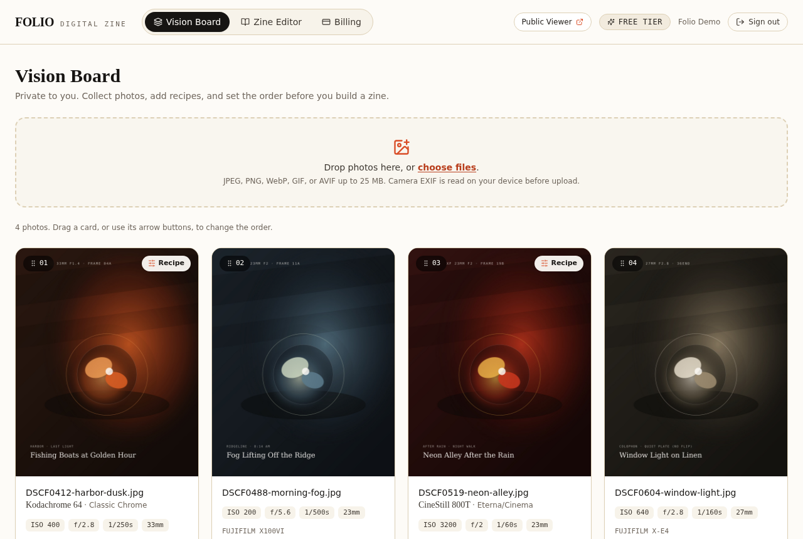
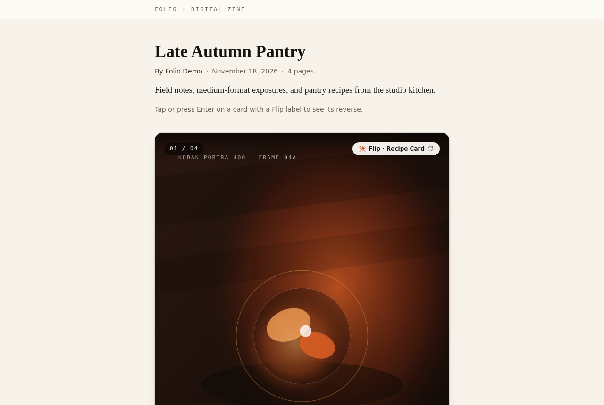
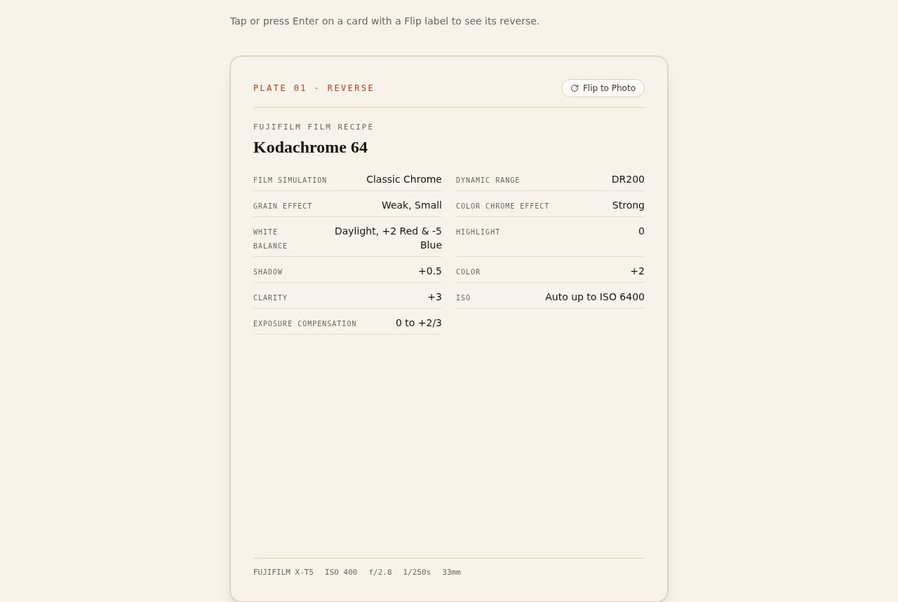

# Digital Zine

Digital Zine (Folio) is for photographers who want their pictures to travel with the settings that made them. Creators collect photos on a private **Vision Board**, sequence them into a full-bleed photo zine, and publish it at `/z/[slug]`. On the public page each card flips over to show the photo's camera EXIF or its **Fujifilm film recipe**: the in-camera settings (film simulation, dynamic range, grain, white balance, tone) that produced the look. Free creators publish zines; Pro subscribers ($15/month) can also export them as PDFs.

Live at **https://folio-digital-zine.app**.

**Stack:** Next.js 15 (App Router) and React 19, PostgreSQL with Prisma 6, Auth.js (email and password, and Google), Tailwind CSS, `sharp` for images and `pg-boss` for the background worker, `@react-pdf/renderer` for PDFs, Stripe for subscriptions, and Resend for email. It runs on Railway with Cloudflare R2 for photos and Sentry for errors.

> The project's current state and active work live on the [Agent handoff](https://linear.app/joshsws/document/agent-handoff-1dfe2c98ac86) page in Linear, not in this file.

| Vision Board | Zine editor |
| --- | --- |
|  |  |

| Public zine | Card flipped to its film recipe | On a phone |
| --- | --- | --- |
|  |  |  |

`npm run smoke` regenerates these screenshots from a running server (see "Scripts").

`npm run smoke` regenerates these screenshots from a running server (see "Scripts").

## Features

### For creators

- **Vision Board.** A private place to collect photos. Upload full-resolution JPEGs (up to 75 MB each). Each photo keeps its camera EXIF, which is read in the browser before upload. Photos are stored as full-resolution AVIF with smaller copies and blur placeholders, so boards stay fast. Boards load 60 photos at a time.
- **Many boards.** Free creators get one board; Pro creators get as many as they like. Rename, reorder, and move photos between boards.
- **Photo names and edits.** Give a photo a name without losing its original file name. Edit it without changing the original: crop ratio, zoom and position, a frame (thin white, white mat, black, Polaroid), and card size. Edits show everywhere, including published zines and PDFs.
- **Fujifilm recipes.** A recipe is the in-camera settings, with the camera's real options for each field. Recipes fill in automatically from a Fujifilm JPEG's maker notes, and creators can keep a private library of saved recipes that update every photo using them.
- **Zine editor.** Build a zine from a board's photos: one full-bleed photo template with an optional caption, ordered pages, and a flip toggle per page. Publish and unpublish, edit the address until the first publish, and delete a zine only by typing its exact title.
- **Public zine page.** `/z/<creator>/<slug>` is server-rendered with Open Graph previews. The creator part is a short public ID that every account gets automatically, so two creators can use the same slug; older `/z/<slug>` links redirect to the new address. Each card flips to its EXIF or film recipe. A creator's email is never shown. Only published zines are visible.
- **PDF export (Pro).** Export a published zine as a PDF.
- **Landing page.** Visitors see what the app is for and what Free and Pro include; signed-in creators go straight to their board.

### Accounts and billing

- **Sign up and sign in.** With an email and password (the email must be verified through a link sent by Resend) or with Google. A Google sign-in links to an existing account only when Google says the email is verified.
- **Plans.** **Free:** 1 board, 1 zine, 2 GB of photo storage, and the public viewer. **Pro ($15/month):** unlimited boards and zines, and PDF export. The 2 GB storage limit applies to every account.
- **Billing.** Stripe Checkout to upgrade and the Stripe Customer Portal to change a card or cancel. A creator who cancels keeps Pro until the end of the paid period, and `/billing` says when that is. A failed renewal keeps Pro with a warning while Stripe retries. Sales tax is optional (Stripe Tax).
- **Admin accounts.** An admin has every Pro feature without a subscription and can preview the app as a Free user.

### Under the hood

- **Security.** Rate limits on sign-in, sign-up, uploads, writes, and PDF export. Storage keys are validated so one creator cannot reach another's files. Uploads are checked and never served as HTML. Original files are deleted once their copies are made, so GPS data inside them is never served. Production refuses to start with a missing or example `AUTH_SECRET`.
- **Search and AI crawlers (DIG-106).** `/robots.txt` welcomes search engines, keeps them out of the signed-in areas, and turns AI-training crawlers away by name (the list is `AI_TRAINING_CRAWLERS` in `src/lib/seo.ts`). `/sitemap.xml` lists the landing page, the legal pages, and every published zine, read live so an unpublished zine drops out at once. Public zines and the landing page carry JSON-LD. `/llms.txt` describes the product for assistants and says the site is not available for AI training. All of them take their address from `NEXT_PUBLIC_APP_URL`. If Cloudflare's managed robots.txt is on, it adds its own AI-crawler rules in front of ours; the two say the same thing.
- **Quality.** Test-driven: unit, component, API, and end-to-end tests run in CI on every pull request.
- **Operations.** Prisma migrations run on every deploy, `GET /api/health` checks the database, and errors go to Sentry.

## Roadmap

This is a direction, not a promise or a schedule. The source of truth is the Linear backlog, and anything not yet started waits for the owner's go-ahead. Items come from that backlog.

**Vision Board redesign**
- Free-form board: place, move, resize, tilt, and stack photos, with a photo tray and sticky notes.
- Grid view (Masonry, Even, Feature layouts) and a strip view grouped by day, with animation between views.
- A new app bar, board bar, and view switch, and a tidier mobile board.

**Reading a zine**
- View a photo full screen, and choose vertical or book-style horizontal reading.
- A background colour that follows each photo, and the recipe shown on the flip side as a film card with a "Shot on" chip and a copy button.
- Generated share images for public zines.

**Editor**
- Drag to reorder pages (with keyboard and screen reader support), a live phone preview, and suggested page orders by recipe, colour, or time.
- Autosaved drafts with undo.

**PDF**
- A template system with palettes and typefaces, starting with Darkroom, then Contact Sheet, Gallery, and Riso.
- A "Style your PDF" panel with live preview, recipe cards in the PDF (style, size, location), and a one-sheet mini zine with fold and cut guides.

**Workflow**
- Select several photos and act on them together, and filter or group by film simulation, recipe, camera, lens, and date.
- Drop or paste uploads with per-file progress, a command menu (⌘K), and an installable app that can receive photos shared from a phone.

**Payments and launch**
- Handling for refunds, disputes, and early fraud warnings.
- Going live on Stripe, source maps in Sentry, and an uptime monitor.

**Out of scope for now:** print-on-demand and proof copies, cover QR codes, Stripe Connect and payouts, audio and video, and asset garbage collection.

## Requirements

- Node.js 22 and npm
- PostgreSQL 15 or newer

## Run it locally

1. Install dependencies.

   ```sh
   npm ci
   ```

2. Copy the environment file and give it a sign-in secret. `.env` is gitignored; never commit it.

   ```sh
   cp .env.example .env
   sed -i "s|^AUTH_SECRET=.*|AUTH_SECRET=\"$(openssl rand -base64 32)\"|" .env
   ```

   A production server refuses to start without a real `AUTH_SECRET` of at least 32 characters, or with a value committed in this repository (DIG-42).

3. Start PostgreSQL. The default `DATABASE_URL` expects database `digital_zine`, user `zine`, password `zine` on `127.0.0.1:5432`. With Docker:

   ```sh
   docker run -d --name digital-zine-pg \
     -e POSTGRES_USER=zine -e POSTGRES_PASSWORD=zine -e POSTGRES_DB=digital_zine \
     -p 127.0.0.1:5432:5432 -v digital-zine-pg:/var/lib/postgresql/data postgres:17
   ```

4. Create the tables and seed sample data.

   ```sh
   npm run db:setup
   ```

   The seed creates a Free-tier user, four Vision Board photos with real EXIF, and a published sample zine at `/z/<the seed user's public ID>/golden-hour-field-notes-issue-01`; `npm run db:seed` prints the full address.

5. Start the dev server and sign in at http://localhost:3000/signin.

   ```sh
   npm run dev
   ```

   | Seeded account | |
   | --- | --- |
   | Email | `creator@digitalzine.local` |
   | Password | `zine1234` |

   Outside production builds, the sign-in form prefills this account. Production builds never show it.

## Develop locally with real services

Everything above runs with no outside accounts. To try Google sign-in or billing while you build, connect your own test accounts to your local `.env`, so you never need production to find out whether something works. **Never copy production's secrets or any live Stripe key onto your machine.** Local `.env` values are yours alone; production keeps its own in Railway.

**Email and Sentry: leave them unset.** Without `RESEND_API_KEY`, sign-up prints the verification link in the dev server's terminal (`[email] RESEND_API_KEY is not set. Verification link for …`); open it in the browser. Without a Sentry DSN nothing is reported, so your development errors do not mix with production's. Photos use local files, so R2 needs nothing either.

**Google sign-in.** Use a separate OAuth client so production's secret stays out of your `.env`:

1. In the [Google Cloud Console](https://console.cloud.google.com/auth/clients), create a client of type **Web application** named "Folio dev".
2. Add one authorized redirect URI: `http://localhost:3000/api/auth/callback/google` (use your dev server's port).
3. Put its ID and secret in `.env` as `AUTH_GOOGLE_ID` and `AUTH_GOOGLE_SECRET`, and restart `npm run dev`. "Continue with Google" appears on the sign-in and sign-up pages.
4. While the Google app is in Testing mode, add your own address under Audience, then Test users.

Leave `AUTH_URL` unset locally; it is only for deploys behind a proxy.

**Billing with a Stripe sandbox.** Stripe cannot reach `localhost`, so the [Stripe CLI](https://docs.stripe.com/stripe-cli) forwards webhooks to it:

1. Install the CLI (on NixOS: `nix shell nixpkgs#stripe-cli`) and run `stripe login`. Pick your **sandbox**, not live mode.
2. In the sandbox, create the "Digital Zine Pro" product with a $15/month price, turn on the Customer Portal, and create a restricted key (`rk_test_…`); see "Billing (Stripe)" below for what the key needs.
3. In `.env`, set `STRIPE_SECRET_KEY` to that key and `STRIPE_PRO_PRICE_ID` to the price's ID. Leave `STRIPE_AUTOMATIC_TAX` empty.
4. In a second terminal, run the forwarder. It prints a signing secret (`whsec_…`); set it as `STRIPE_WEBHOOK_SECRET` and restart the dev server.

   ```sh
   stripe listen --forward-to localhost:3000/api/billing/webhook
   ```

5. Sign in, open `/billing`, and upgrade with the test card `4242 4242 4242 4242` (any future expiry, any CVC). The page should turn to Pro within seconds, and the forwarder's terminal shows each event delivered.

The forwarder's secret is not the same as the one on a webhook endpoint in the Stripe dashboard. Use the dashboard endpoint's secret only on a deployed site.

## Scripts

| Command | What it does |
| --- | --- |
| `npm run dev` | Development server |
| `npm run build` | `prisma generate` followed by `next build` |
| `npm start` | Serves the production build |
| `npm run db:migrate -- --name <change>` | After editing `prisma/schema.prisma`: writes a new migration in `prisma/migrations/` and applies it to your dev database (`prisma migrate dev`) |
| `npm run db:deploy` | Applies pending migrations (`prisma migrate deploy`). Production runs this on every deploy |
| `npm run db:check-migrations` | Proves the migrations build a database that matches `schema.prisma`, on a fresh database and on a `db push` one. CI runs it |
| `npm run db:push` | Applies the schema without migrations. Only for the test database and quick local experiments |
| `npm run db:seed` | Reseeds the sample user, assets, and zine |
| `npm run db:setup` | `db:deploy` followed by `db:seed` |
| `npm test` | Unit, component, and API tests (Vitest): both projects below |
| `npm run test:fast` | Unit and component tests only, in parallel, with no database |
| `npm run test:api` | API tests only, against the test database, one file at a time |
| `npm run typecheck` | `tsc --noEmit` over the whole project, test files included |
| `npm run test:watch` | Vitest in watch mode |
| `npm run test:e2e` | Builds the app, starts it on port 3417, and runs the Playwright browser tests against the test database |
| `npm run test:db:reset` | Applies the schema to the test database, empties it, and reseeds it |
| `npm run admin:create -- --email <email>` | Creates an admin account, or promotes an existing one (see "Admin accounts") |
| `npm run smoke` | Smoke-checks a running server and refreshes `docs/screenshots/` (set `SMOKE_BASE_URL`) |

## Testing

This project is test-driven. Write a failing test, make it pass, then refactor. `AGENTS.md` holds the full rules, and `tests/AGENTS.md` the commands and traps.

| Layer | Tool | Where |
| --- | --- | --- |
| Unit | Vitest | `src/**/*.test.ts`, next to the code |
| Component | Vitest, Testing Library, jsdom | `src/**/*.test.tsx`, next to the component |
| API route handlers | Vitest against Postgres | `tests/api/` |
| End to end | Playwright against `next start` | `tests/e2e/` |

Vitest has two projects. `fast` (unit and component, `src/`) needs no database and runs files in parallel. `api` (`tests/api/`) resets the test database once and runs files one at a time, because they share it.

Tests use the separate `digital_zine_test` database from `.env.test`. That file is committed because it holds only local, non-secret values. To use another database (for example a second checkout), put `DATABASE_URL` in the gitignored `.env.test.local`, which overrides `.env.test`; `scripts/worktree-new.sh` writes it for you. `npm run test:api` and `npm run test:e2e` reset and seed the test database before each run. The reset refuses to touch any database whose name does not end in `_test`, so your dev data is safe. The Postgres user must be allowed to create that database; the Docker command above allows it.

Before the first browser run, install Chromium:

```sh
npx playwright install chromium
```

Which tests a change needs depends on its risk ([decision 0026](docs/decisions/0026-testing-by-risk.md)):

| Change | Test |
| --- | --- |
| Color, spacing, copy | Look at it; `npm run typecheck` for code |
| Button or other UI behavior | One component test |
| Logic | Unit test |
| API route | API tests, including auth and abuse cases |
| Upload, sign-up, publish, viewer, billing, deletion | The above, plus that flow's e2e spec |
| Auth, payments, schema, middleware, dependencies | Everything |

CI (`.github/workflows/ci.yml`) runs the type check, the build, `npm test`, and `npm run test:e2e` on every push and pull request.

## Environment variables

Every variable lives in `.env.example`. Only the first group is required.

| Variable | Required | Purpose |
| --- | --- | --- |
| `DATABASE_URL` | Yes | PostgreSQL connection string |
| `AUTH_SECRET` | Yes | Auth.js signing secret. Generate one with `openssl rand -base64 32`. A production server will not start if it is missing, shorter than 32 characters, or a value committed in this repository. |
| `AUTH_TRUST_HOST` | Yes | `true` when running behind a proxy or on localhost |
| `AUTH_URL` | In production | The public URL, such as `https://folio-digital-zine.app`. Behind a proxy, Auth.js otherwise builds URLs from the container's own address (`https://localhost:8080`), so Google sign-in fails with `redirect_uri_mismatch`. It must match the host of the Google redirect URI. Not needed locally. |
| `NEXT_PUBLIC_APP_URL` | Yes | Canonical public URL, used for Open Graph links and Stripe redirects |
| `LOCAL_STORAGE_DIR` | No | Upload directory for the local storage driver. Default: `.data/uploads` |
| `AWS_S3_BUCKET`, `AWS_REGION`, `AWS_ACCESS_KEY_ID`, `AWS_SECRET_ACCESS_KEY` | No | When all four are set, uploads go straight to S3 through presigned PUT URLs |
| `AWS_S3_ENDPOINT` | No | Endpoint for S3-compatible stores such as R2 or MinIO |
| `AWS_S3_PUBLIC_URL` | No | Public base URL for reading objects |
| `NEXT_PUBLIC_IMAGE_CDN_URL` | No | Image CDN prefix. See below. |
| `STRIPE_SECRET_KEY`, `STRIPE_WEBHOOK_SECRET`, `STRIPE_PRO_PRICE_ID`, `STRIPE_AUTOMATIC_TAX` | No | Pro subscription billing and sales tax (see "Billing" below). If these are unset, billing reports that it is not configured and the rest of the app keeps working. |
| `RESEND_API_KEY`, `EMAIL_FROM` | Production | Send verification emails (see "Sign-up"). Without a key, production refuses sign-up; elsewhere the link is printed to the console. `RESEND_API_URL` overrides the endpoint, for tests. |
| `AUTH_GOOGLE_ID`, `AUTH_GOOGLE_SECRET` | No | Turn on Continue with Google (see "Sign-up"). Unset hides the button. |
| `TRUSTED_PROXY_HOPS` | No | How many proxies sit in front of the app, for reading the client IP (see "Sign-in rate limits"). Default: `1` |
| `CSP_MODE` | No | `enforce` makes the Content Security Policy block violations. Anything else (the default) only reports them to `/api/csp-report` and Sentry. Deploy report-only, watch for a day, then set `enforce`. |
| `SENTRY_DSN`, `NEXT_PUBLIC_SENTRY_DSN` | No | Report server and browser errors to Sentry. Unset means nothing is sent. `NEXT_PUBLIC_SENTRY_DSN` is read at build time. |
| `SENTRY_AUTH_TOKEN`, `SENTRY_ORG`, `SENTRY_PROJECT` | No | Build time only: upload source maps so Sentry shows readable stack traces |

## Sign-up, email verification, and Google (DIG-94)

Creators sign up at `/signup` with a name, email, and password, or with Google. A password account must verify its email before it can sign in: the sign-up sends a single-use link, valid for 24 hours, and opening it signs the creator in. Only a hash of the token is stored. Google accounts count as verified. A Google sign-in whose email already has an account links to it, but only when Google reports the email as verified. Existing accounts were marked verified by the migration.

Sign-up is limited to 10 per IP per hour, and asking for another link to 3 per email and 20 per IP per hour.

**Email** goes through [Resend](https://resend.com) over plain HTTPS. Set `RESEND_API_KEY` and `EMAIL_FROM` (an address on a domain verified in Resend). Without a key, a production server answers sign-up with "email is not set up" and creates nothing. Anywhere else the link is printed to the server console, so local sign-up works with no account.

**Google** needs an OAuth client. In the [Google Cloud Console](https://console.cloud.google.com/apis/credentials) create an OAuth client ID of type "Web application" and add these authorized redirect URIs:

- `http://localhost:3000/api/auth/callback/google` (use your dev port)
- `https://<your domain>/api/auth/callback/google`

Then set `AUTH_GOOGLE_ID` and `AUTH_GOOGLE_SECRET`. The Google buttons only appear when both are set.

## Forgot password (DIG-107)

`/signin` links to `/forgot-password`. Whoever asks gets the same answer ("If that address has an account, we sent a link") and the answer goes out before the address is looked up, so neither the wording nor the response time shows who has an account. A password account is emailed a link valid for one hour; a Google-only account is emailed a reminder to sign in with Google; an unknown address gets nothing. Only a hash of the token is stored, and asking again retires the older link. Requests are limited to 3 per email and 20 per IP per hour, and attempts to use a link to 20 per IP per hour.

Opening the link (`/reset-password?token=…`) spends nothing; submitting a new password does, once. A refused password (too short, too long, not matching, or the account's own email) does not use the link up. A reset changes the password, retires every other reset link, marks the email verified, signs the creator in, and **signs out every session from before the reset**: each session records when it began, the account records `sessionsValidAfter`, and every check compares the two. Reset emails go through the same Resend setup as verification.

## Deleting an account (DIG-108)

`/account` (linked from the studio header) has a "Delete account" section that lists exactly what goes: the Vision Boards and photos and every stored copy, the zines (published ones stop working at once and leave the sitemap), saved recipes, and the account. The creator types their email address and gives the account's password; an account with no password (Google only) must have signed in within the last five minutes instead. A password that is given must be right. Attempts are limited to 5 per creator per hour.

The order is repeatable: any live Stripe subscription is cancelled first, immediately and with no refund (refunds are DIG-15), and the Stripe customer is deleted; then every file under `users/<id>/` is deleted from storage; then the database row goes, and its cascades remove the rest. If a step fails, the account stays, the creator is told to try again, and the error goes to Sentry tagged `area: account-deletion` with the account's ID only. A retry skips what is already done. The only admin cannot delete their own account. Deleting the Stripe customer removes the saved card and contact details; Stripe keeps its own payment records as the law requires.

## Billing (Stripe)

Pro costs $15/month and unlocks PDF export. `/billing` shows the plan, starts Stripe Checkout, and opens Stripe's hosted Customer Portal, where Pro users cancel, change their card, or see invoices.

To turn it on:

1. Use a [Stripe sandbox](https://docs.stripe.com/sandboxes) for development, and a [restricted API key](https://docs.stripe.com/keys#limit-access) (`rk_…`) where you can. The key needs write access to Customers, Checkout Sessions, and Customer Portal sessions, and read access to Subscriptions.
2. Create a Product named "Digital Zine Pro" with a $15/month recurring Price, and set `STRIPE_PRO_PRICE_ID`. If it is unset, Checkout falls back to an inline $15/month price.
3. Turn on the Customer Portal in the Dashboard (Settings → Billing → Customer portal), and allow cancellation and payment-method updates.
4. Add a webhook endpoint at `<NEXT_PUBLIC_APP_URL>/api/billing/webhook` and set `STRIPE_WEBHOOK_SECRET` to its signing secret. Subscribe to:
   - `checkout.session.completed`, `checkout.session.async_payment_succeeded`
   - `customer.subscription.created`, `.updated`, `.deleted`, `.paused`, `.resumed`
   - `invoice.paid`, `invoice.payment_failed`
   - `charge.refunded`, `charge.dispute.created`, `radar.early_fraud_warning.created` (money at risk, DIG-15)

   For local testing: `stripe listen --forward-to localhost:3000/api/billing/webhook`.

How it behaves:

- The webhook re-reads the customer's subscriptions from Stripe instead of trusting the event payload, and the plan follows the best of them (active, then trialing, then past due, newest first). So events that arrive out of order, or a late event for an old subscription, cannot downgrade a paying creator (DIG-39). It finds users only by their linked Stripe customer.
- Checkout asks Stripe first and refuses (409) when the customer already has a live subscription, even if the app has not caught up yet.
- `active`, `trialing`, and `past_due` count as Pro. While Stripe retries a failed renewal, the creator keeps Pro and sees a warning on `/billing`. They drop to Free when the subscription becomes `unpaid` or `canceled`.
- Without `STRIPE_SECRET_KEY` or `NEXT_PUBLIC_APP_URL`, `/billing` says billing is not set up and the billing APIs return 503. The rest of the app is unaffected.
- **Money at risk (DIG-15).** A full refund of a subscription's latest payment cancels the subscription at once and the creator drops to Free (the webhook follows the charge to its payment intent, invoice, and subscription, then finds the user by the linked Stripe customer). A partial refund, or a refund of an older payment, changes nothing. A dispute and an early fraud warning change nothing for the creator. All of them are reported to Sentry (`area: stripe-risk`), with Stripe IDs, amounts, and our user ID but no email or name, so watch Sentry for them; a dispute is an `error`, the rest are `warning`. Contest or refund in the Stripe dashboard.

### Sales tax (Stripe Tax)

Pro is priced **$15/month plus applicable tax**: tax is added on top. Set `STRIPE_AUTOMATIC_TAX=true` to turn it on. Checkout then sends `automatic_tax`, collects the customer's billing address and saves it to their Stripe customer, and `/billing` shows "$15/month plus applicable tax". Leave it unset and Checkout charges $15 with no tax.

Turn the flag on only after this Stripe-side setup, done separately in each sandbox and in live mode:

1. **Tax settings.** Dashboard → Tax → Settings: set the head office address. Until then, Stripe rejects Checkout Sessions that ask for automatic tax.
2. **Product tax code and tax behavior.** On the Pro Product, choose the tax code that fits a digital subscription from [Stripe's tax code list](https://docs.stripe.com/tax/tax-codes) (see [tax codes for digital products](https://docs.stripe.com/tax/digital-products)), and confirm it with your tax advisor. On the Price used for `STRIPE_PRO_PRICE_ID`, set tax behavior to **Exclusive**. The inline fallback price already sends `tax_behavior: "exclusive"` and uses the account's preset tax code.
3. **Registrations.** Dashboard → Tax → Locations: add a registration for each place where you are registered to collect tax. **Stripe collects no tax, and shows no error, in any jurisdiction without an active registration.** Adding one in Stripe only records a registration you already hold with the tax authority; it does not register you. In the US, eligible sellers can use "Register for me". Your tax advisor decides where you must register.
4. **Monitoring.** Dashboard → Tax → Locations → "Needs attention" flags jurisdictions where your live sales may be nearing a registration threshold. Sandbox sales don't count.
5. **Check it.** In a sandbox, run a checkout with an address in a jurisdiction you registered. On the session's line items, `taxability_reason` should not be `not_collecting`.

Filing returns is separate from collecting tax; see [Stripe's filing options](https://docs.stripe.com/tax/filing).

## Storage

`src/lib/storage/` picks the driver at request time:

- **Local** (default). Browsers upload with `PUT /api/uploads/local/[...key]` to `LOCAL_STORAGE_DIR`, and files are read from `GET /api/media/[...key]`.
- **S3**. `POST /api/uploads/presign` returns a presigned PUT URL, and the browser uploads directly to the bucket.

The browser reads EXIF with `exifreader` before it uploads.

## Swapping in an image CDN

`next/image` uses the custom loader in `src/lib/image-loader.ts`.

- With `NEXT_PUBLIC_IMAGE_CDN_URL` unset, images load from their own URL with `?w=` and `&q=` hints appended.
- With it set, the loader requests `<CDN>?url=<encoded src>&w=<width>&q=<quality>`. This fits image proxies that take a source URL, such as an Imgix web-proxy source or a CloudFront image handler.

The loader is the only file to change if your CDN expects a different URL shape. Because the variable is `NEXT_PUBLIC_`, it is inlined at build time, so rebuild after you change it.

## Admin accounts

Admins have every Pro feature, including PDF export, without a Stripe subscription. They can't see other users' data.

```bash
npm run admin:create -- --email you@example.com            # create, or promote an existing account
npm run admin:create -- --email you@example.com --reset    # set a new password
```

A new account, or `--reset`, gets a random password that is printed once. Store it in a password manager. Promoting an existing account keeps its password. The command works against whatever database `DATABASE_URL` points to. Run `npm run db:deploy` first so the database is up to date.

Signed-in admins see an "Admin" badge and a **View as Free** switch in the studio header. Turning it on shows the app exactly as a Free user sees it: the PDF upsell, a 403 from the PDF API, and the Free plan on `/billing`. A banner stays up until you switch back. The setting lives in an httpOnly cookie, so it survives reloads. It can only remove access: regular users can't use it, and admins can never start a Stripe checkout.

## Schema changes and migrations

Production schema changes ship as Prisma migrations in `prisma/migrations/` (DIG-19). The first one, `20261119000000_baseline`, is the whole schema as of 19 Nov 2026.

- **Changing the schema:** edit `prisma/schema.prisma`, run `npm run db:migrate -- --name <short-change-name>`, and commit the new folder in `prisma/migrations/` with the schema. Never edit a migration that has been merged.
- **A database set up with `db push` before migrations existed** (any local dev database from before 19 Nov 2026): run `npx prisma migrate resolve --applied 20261119000000_baseline` once, then `npm run db:deploy`.
- **The test database** keeps `db push`: `npm test` and `npm run test:e2e` reset it that way. Migrations are proven separately by `npm run db:check-migrations`, which CI runs.
- **Production:** run `npm run db:deploy` before starting the new version.

## Sign-in rate limits and the client IP

Failed sign-ins are limited to 5 per email from one IP and 20 per IP, per 15 minutes (DIG-28, DIG-37). Counting an email per IP means someone else's failures cannot lock a creator out.

The client IP is read from `X-Forwarded-For`. Each proxy in front of the app appends the address that connected to it, so the real client is the entry `TRUSTED_PROXY_HOPS` places from the right (default `1`). Anything further left came from the client and may be forged. Set `TRUSTED_PROXY_HOPS` to the number of proxies your host puts in front of the app: usually `1`, or `2` behind a CDN and a load balancer.

## Deploy (Railway)

Production runs on [Railway](https://railway.com) as one always-on service, with Railway Postgres and Cloudflare R2 for photos. It is not serverless: the media worker and the public page cache run inside the app.

Railway does not let new services use `railway.json`, so the service settings live on the service itself (Railway, then the service, then Settings). Set these once:

| Setting | Value |
| --- | --- |
| Builder | Railpack (default), build command `npm run build` |
| Pre-deploy command | `npm run db:deploy` (applies migrations before each new version starts) |
| Start command | `npm run start` |
| Healthcheck path | `/api/health` (200 when the database answers, 503 when not), timeout 120 s |
| Restart policy | On failure, 5 retries |

Set these on the app service:

| Variable | Value |
| --- | --- |
| `DATABASE_URL` | `${{Postgres.DATABASE_URL}}` (Railway's private network, direct connection) |
| `AUTH_SECRET` | `openssl rand -base64 32`, never a value from this repository |
| `AUTH_TRUST_HOST` | `true` |
| `AUTH_URL` | The public URL, the same as `NEXT_PUBLIC_APP_URL`. Without it Google sign-in sends `https://localhost:8080/...` as its redirect and fails. |
| `NEXT_PUBLIC_APP_URL` | `https://<service>.up.railway.app`, or the custom domain. Read at build time, so change it and redeploy together. |
| `TRUSTED_PROXY_HOPS` | `1` on Railway's own address; `2` when Cloudflare proxies a custom domain in front of Railway |
| `AWS_S3_BUCKET`, `AWS_ACCESS_KEY_ID`, `AWS_SECRET_ACCESS_KEY` | The R2 bucket and an R2 API token with Object Read & Write on that bucket |
| `AWS_REGION` | `auto` |
| `AWS_S3_ENDPOINT` | `https://<account id>.r2.cloudflarestorage.com` |
| `AWS_S3_PUBLIC_URL` | The bucket's public URL (`https://pub-<id>.r2.dev`, or a custom domain) |
| `SENTRY_DSN`, `NEXT_PUBLIC_SENTRY_DSN` | The Sentry project's DSN |
| `RESEND_API_KEY`, `EMAIL_FROM` | Resend API key, and a sender on a domain verified in Resend. Sign-up does not work in production without them. |
| `AUTH_GOOGLE_ID`, `AUTH_GOOGLE_SECRET` | The Google OAuth client (see "Sign-up"). Optional. |
| `STRIPE_*` | Live keys (see "Billing") |

The R2 bucket needs public read access and a CORS rule that allows `PUT` with the `Content-Type` header from `NEXT_PUBLIC_APP_URL`:

```json
[{ "AllowedOrigins": ["https://<service>.up.railway.app"], "AllowedMethods": ["PUT"], "AllowedHeaders": ["Content-Type"], "MaxAgeSeconds": 3600 }]
```

After a deploy, check it with `SMOKE_BASE_URL=<url> SMOKE_SCREENSHOTS=0 npm run smoke`. Point an uptime monitor at `/api/health`.

## NixOS

Prisma has no prebuilt engines for NixOS. Use the matching `prisma-engines_6` package from nixpkgs (6.19.3, the same version as the lockfile) and point Prisma at it:

```sh
E=$(nix build --no-link --print-out-paths nixpkgs#prisma-engines_6)
export PRISMA_QUERY_ENGINE_LIBRARY=$E/lib/libquery_engine.node
export PRISMA_SCHEMA_ENGINE_BINARY=$E/bin/schema-engine
export PRISMA_ENGINES_CHECKSUM_IGNORE_MISSING=1
nix shell nixpkgs#nodejs_22 nixpkgs#openssl -c npm run build
```

Playwright cannot download its own browser on NixOS. Point it at the nixpkgs Chromium instead:

```sh
export PLAYWRIGHT_CHROMIUM_EXECUTABLE=$(nix build --no-link --print-out-paths nixpkgs#chromium)/bin/chromium
npm run test:e2e
```
