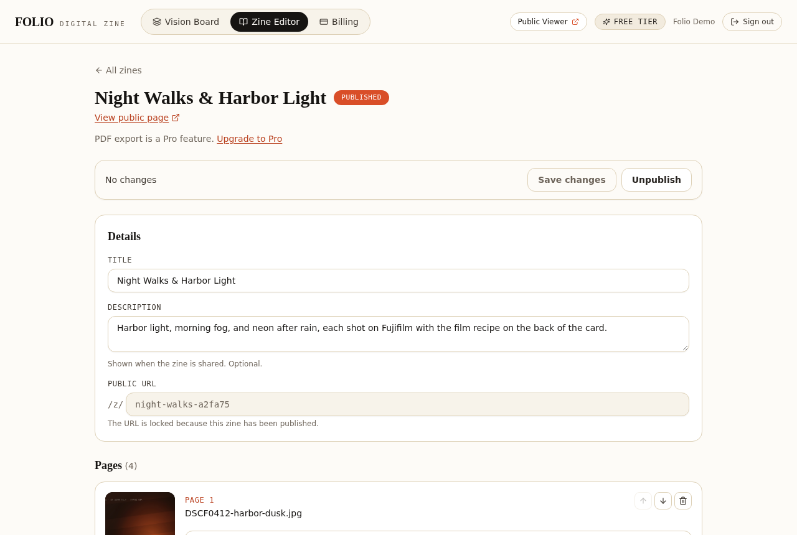

# Digital Zine

Creators collect photos on a private Vision Board, sequence them into a full-bleed photo zine, and publish it at `/z/[slug]`. On the public page, each card flips over to show the photo's camera EXIF or its Fujifilm film recipe: the in-camera settings (film simulation, dynamic range, grain, white balance, tone) that produced the look. Pro subscribers ($15/month) can export a published zine as a PDF.

Stack: Next.js 15 App Router, React 19, PostgreSQL with Prisma 6, Auth.js credentials, `@react-pdf/renderer`, and Stripe subscriptions.

> Status: the MVP is merged into `main` (PR #1). Current work, including which Linear project is active, is on the [Agent handoff](https://linear.app/digital-zine/document/agent-handoff-186930851c71) page.

| Vision Board | Zine editor |
| --- | --- |
|  |  |

| Public zine | Card flipped to its film recipe | On a phone |
| --- | --- | --- |
|  |  |  |

`npm run smoke` regenerates these screenshots from a running server (see "Scripts").

## Requirements

- Node.js 22 and npm
- PostgreSQL 15 or newer

## Run it locally

1. Install dependencies.

   ```sh
   npm ci
   ```

2. Copy the environment file and give it a sign-in secret. `.env` is gitignored; never commit it.

   ```sh
   cp .env.example .env
   sed -i "s|^AUTH_SECRET=.*|AUTH_SECRET=\"$(openssl rand -base64 32)\"|" .env
   ```

   A production server refuses to start without a real `AUTH_SECRET` of at least 32 characters, or with a value committed in this repository (DIG-42).

3. Start PostgreSQL. The default `DATABASE_URL` expects database `digital_zine`, user `zine`, password `zine` on `127.0.0.1:5432`. With Docker:

   ```sh
   docker run -d --name digital-zine-pg \
     -e POSTGRES_USER=zine -e POSTGRES_PASSWORD=zine -e POSTGRES_DB=digital_zine \
     -p 127.0.0.1:5432:5432 -v digital-zine-pg:/var/lib/postgresql/data postgres:17
   ```

4. Create the tables and seed sample data.

   ```sh
   npm run db:setup
   ```

   The seed creates a Free-tier user, four Vision Board photos with real EXIF, and a published sample zine at `/z/golden-hour-field-notes-issue-01`.

5. Start the dev server and sign in at http://localhost:3000/signin.

   ```sh
   npm run dev
   ```

   | Seeded account | |
   | --- | --- |
   | Email | `creator@digitalzine.local` |
   | Password | `zine1234` |

   Outside production builds, the sign-in form prefills this account. Production builds never show it.

## Scripts

| Command | What it does |
| --- | --- |
| `npm run dev` | Development server |
| `npm run build` | `prisma generate` followed by `next build` |
| `npm start` | Serves the production build |
| `npm run db:migrate -- --name <change>` | After editing `prisma/schema.prisma`: writes a new migration in `prisma/migrations/` and applies it to your dev database (`prisma migrate dev`) |
| `npm run db:deploy` | Applies pending migrations (`prisma migrate deploy`). Production runs this on every deploy |
| `npm run db:check-migrations` | Proves the migrations build a database that matches `schema.prisma`, on a fresh database and on a `db push` one. CI runs it |
| `npm run db:push` | Applies the schema without migrations. Only for the test database and quick local experiments |
| `npm run db:seed` | Reseeds the sample user, assets, and zine |
| `npm run db:setup` | `db:deploy` followed by `db:seed` |
| `npm test` | Unit, component, and API tests (Vitest) against the test database |
| `npm run test:watch` | Vitest in watch mode |
| `npm run test:e2e` | Builds the app, starts it on port 3417, and runs the Playwright browser tests against the test database |
| `npm run test:db:reset` | Applies the schema to the test database, empties it, and reseeds it |
| `npm run admin:create -- --email <email>` | Creates an admin account, or promotes an existing one (see "Admin accounts") |
| `npm run smoke` | Smoke-checks a running server and refreshes `docs/screenshots/` (set `SMOKE_BASE_URL`) |

## Schema changes and migrations

Production schema changes ship as Prisma migrations in `prisma/migrations/` (DIG-19). The first one, `20261119000000_baseline`, is the whole schema as of 19 Nov 2026.

- **Changing the schema:** edit `prisma/schema.prisma`, run `npm run db:migrate -- --name <short-change-name>`, and commit the new folder in `prisma/migrations/` with the schema. Never edit a migration that has been merged.
- **A database set up with `db push` before migrations existed** (any local dev database from before 19 Nov 2026): run `npx prisma migrate resolve --applied 20261119000000_baseline` once, then `npm run db:deploy`.
- **The test database** keeps `db push`: `npm test` and `npm run test:e2e` reset it that way. Migrations are proven separately by `npm run db:check-migrations`, which CI runs.
- **Production:** run `npm run db:deploy` before starting the new version.

## Testing

This project is test-driven. Write a failing test, make it pass, then refactor. `CLAUDE.md` and `.cursor/rules/test-driven.mdc` hold the full rules.

| Layer | Tool | Where |
| --- | --- | --- |
| Unit | Vitest | `src/**/*.test.ts`, next to the code |
| Component | Vitest, Testing Library, jsdom | `src/**/*.test.tsx`, next to the component |
| API route handlers | Vitest against Postgres | `tests/api/` |
| End to end | Playwright against `next start` | `tests/e2e/` |

Tests use the separate `digital_zine_test` database from `.env.test`. That file is committed because it holds only local, non-secret values. `npm test` and `npm run test:e2e` reset and seed the test database before each run. The reset refuses to touch any database whose name does not end in `_test`, so your dev data is safe. The Postgres user must be allowed to create that database; the Docker command above allows it.

Before the first browser run, install Chromium:

```sh
npx playwright install chromium
```

CI (`.github/workflows/ci.yml`) runs the build, `npm test`, and `npm run test:e2e` on every push and pull request.

## Environment variables

Every variable lives in `.env.example`. Only the first group is required.

| Variable | Required | Purpose |
| --- | --- | --- |
| `DATABASE_URL` | Yes | PostgreSQL connection string |
| `AUTH_SECRET` | Yes | Auth.js signing secret. Generate one with `openssl rand -base64 32`. A production server will not start if it is missing, shorter than 32 characters, or a value committed in this repository. |
| `AUTH_TRUST_HOST` | Yes | `true` when running behind a proxy or on localhost |
| `NEXT_PUBLIC_APP_URL` | Yes | Canonical public URL, used for Open Graph links and Stripe redirects |
| `LOCAL_STORAGE_DIR` | No | Upload directory for the local storage driver. Default: `.data/uploads` |
| `AWS_S3_BUCKET`, `AWS_REGION`, `AWS_ACCESS_KEY_ID`, `AWS_SECRET_ACCESS_KEY` | No | When all four are set, uploads go straight to S3 through presigned PUT URLs |
| `AWS_S3_ENDPOINT` | No | Endpoint for S3-compatible stores such as R2 or MinIO |
| `AWS_S3_PUBLIC_URL` | No | Public base URL for reading objects |
| `NEXT_PUBLIC_IMAGE_CDN_URL` | No | Image CDN prefix. See below. |
| `STRIPE_SECRET_KEY`, `STRIPE_WEBHOOK_SECRET`, `STRIPE_PRO_PRICE_ID`, `STRIPE_AUTOMATIC_TAX` | No | Pro subscription billing and sales tax (see "Billing" below). If these are unset, billing reports that it is not configured and the rest of the app keeps working. |

## Admin accounts

Admins have every Pro feature, including PDF export, without a Stripe subscription. They can't see other users' data.

```bash
npm run admin:create -- --email you@example.com            # create, or promote an existing account
npm run admin:create -- --email you@example.com --reset    # set a new password
```

A new account, or `--reset`, gets a random password that is printed once. Store it in a password manager. Promoting an existing account keeps its password. The command works against whatever database `DATABASE_URL` points to. Run `npm run db:deploy` first so the database is up to date.

Signed-in admins see an "Admin" badge and a **View as Free** switch in the studio header. Turning it on shows the app exactly as a Free user sees it: the PDF upsell, a 403 from the PDF API, and the Free plan on `/billing`. A banner stays up until you switch back. The setting lives in an httpOnly cookie, so it survives reloads. It can only remove access: regular users can't use it, and admins can never start a Stripe checkout.

## Billing (Stripe)

Pro costs $15/month and unlocks PDF export. `/billing` shows the plan, starts Stripe Checkout, and opens Stripe's hosted Customer Portal, where Pro users cancel, change their card, or see invoices.

To turn it on:

1. Use a [Stripe sandbox](https://docs.stripe.com/sandboxes) for development, and a [restricted API key](https://docs.stripe.com/keys#limit-access) (`rk_…`) where you can. The key needs write access to Customers, Checkout Sessions, and Customer Portal sessions, and read access to Subscriptions.
2. Create a Product named "Digital Zine Pro" with a $15/month recurring Price, and set `STRIPE_PRO_PRICE_ID`. If it is unset, Checkout falls back to an inline $15/month price.
3. Turn on the Customer Portal in the Dashboard (Settings → Billing → Customer portal), and allow cancellation and payment-method updates.
4. Add a webhook endpoint at `<NEXT_PUBLIC_APP_URL>/api/billing/webhook` and set `STRIPE_WEBHOOK_SECRET` to its signing secret. Subscribe to:
   - `checkout.session.completed`, `checkout.session.async_payment_succeeded`
   - `customer.subscription.created`, `.updated`, `.deleted`, `.paused`, `.resumed`
   - `invoice.paid`, `invoice.payment_failed`

   For local testing: `stripe listen --forward-to localhost:3000/api/billing/webhook`.

How it behaves:

- The webhook re-reads each subscription from Stripe instead of trusting the event payload, so events that arrive out of order are handled. It finds users only by their linked Stripe customer.
- `active`, `trialing`, and `past_due` count as Pro. While Stripe retries a failed renewal, the creator keeps Pro and sees a warning on `/billing`. They drop to Free when the subscription becomes `unpaid` or `canceled`.
- Without `STRIPE_SECRET_KEY` or `NEXT_PUBLIC_APP_URL`, `/billing` says billing is not set up and the billing APIs return 503. The rest of the app is unaffected.
- Not handled yet: refund, dispute, and early-fraud-warning events (DIG-15).

### Sales tax (Stripe Tax)

Pro is priced **$15/month plus applicable tax**: tax is added on top. Set `STRIPE_AUTOMATIC_TAX=true` to turn it on. Checkout then sends `automatic_tax`, collects the customer's billing address and saves it to their Stripe customer, and `/billing` shows "$15/month plus applicable tax". Leave it unset and Checkout charges $15 with no tax.

Turn the flag on only after this Stripe-side setup, done separately in each sandbox and in live mode:

1. **Tax settings.** Dashboard → Tax → Settings: set the head office address. Until then, Stripe rejects Checkout Sessions that ask for automatic tax.
2. **Product tax code and tax behavior.** On the Pro Product, choose the tax code that fits a digital subscription from [Stripe's tax code list](https://docs.stripe.com/tax/tax-codes) (see [tax codes for digital products](https://docs.stripe.com/tax/digital-products)), and confirm it with your tax advisor. On the Price used for `STRIPE_PRO_PRICE_ID`, set tax behavior to **Exclusive**. The inline fallback price already sends `tax_behavior: "exclusive"` and uses the account's preset tax code.
3. **Registrations.** Dashboard → Tax → Locations: add a registration for each place where you are registered to collect tax. **Stripe collects no tax, and shows no error, in any jurisdiction without an active registration.** Adding one in Stripe only records a registration you already hold with the tax authority; it does not register you. In the US, eligible sellers can use "Register for me". Your tax advisor decides where you must register.
4. **Monitoring.** Dashboard → Tax → Locations → "Needs attention" flags jurisdictions where your live sales may be nearing a registration threshold. Sandbox sales don't count.
5. **Check it.** In a sandbox, run a checkout with an address in a jurisdiction you registered. On the session's line items, `taxability_reason` should not be `not_collecting`.

Filing returns is separate from collecting tax; see [Stripe's filing options](https://docs.stripe.com/tax/filing).

## Storage

`src/lib/storage/` picks the driver at request time:

- **Local** (default). Browsers upload with `PUT /api/uploads/local/[...key]` to `LOCAL_STORAGE_DIR`, and files are read from `GET /api/media/[...key]`.
- **S3**. `POST /api/uploads/presign` returns a presigned PUT URL, and the browser uploads directly to the bucket.

The browser reads EXIF with `exifreader` before it uploads.

## Swapping in an image CDN

`next/image` uses the custom loader in `src/lib/image-loader.ts`.

- With `NEXT_PUBLIC_IMAGE_CDN_URL` unset, images load from their own URL with `?w=` and `&q=` hints appended.
- With it set, the loader requests `<CDN>?url=<encoded src>&w=<width>&q=<quality>`. This fits image proxies that take a source URL, such as an Imgix web-proxy source or a CloudFront image handler.

The loader is the only file to change if your CDN expects a different URL shape. Because the variable is `NEXT_PUBLIC_`, it is inlined at build time, so rebuild after you change it.

## NixOS

Prisma has no prebuilt engines for NixOS. Use the matching `prisma-engines_6` package from nixpkgs (6.19.3, the same version as the lockfile) and point Prisma at it:

```sh
E=$(nix build --no-link --print-out-paths nixpkgs#prisma-engines_6)
export PRISMA_QUERY_ENGINE_LIBRARY=$E/lib/libquery_engine.node
export PRISMA_SCHEMA_ENGINE_BINARY=$E/bin/schema-engine
export PRISMA_ENGINES_CHECKSUM_IGNORE_MISSING=1
nix shell nixpkgs#nodejs_22 nixpkgs#openssl -c npm run build
```

Playwright cannot download its own browser on NixOS. Point it at the nixpkgs Chromium instead:

```sh
export PLAYWRIGHT_CHROMIUM_EXECUTABLE=$(nix build --no-link --print-out-paths nixpkgs#chromium)/bin/chromium
npm run test:e2e
```
